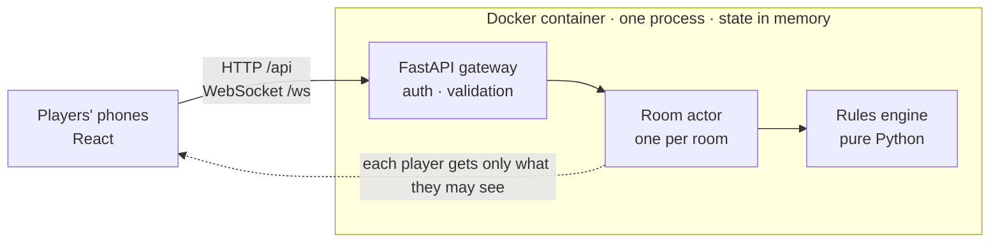

# One Night Ultimate Werewolf · Web

[简体中文](README.md) | English

<p align="center">
  
</p>

<p align="center">
  
  
  
</p>

A self-hosted companion for the board game *One Night Ultimate Werewolf*

## Screenshots

<p align="center">
  
  
</p>

## Create your own card

Send this to an AI coding tool such as Claude Code or Codex, with the card lines changed to your own card:

```text
Clone https://github.com/961853266hyt/ultimate-one-night-wolf and add a new card for me.

Card: Night Owl
Team: Village
Ability: whenever any role wakes up at night, the Night Owl may open their eyes too and see who is awake at that step. Once per night.
If unused: they can keep their eyes closed all night and nothing happens.

If any rule is unclear, ask me instead of guessing. When it's done, start the front end and back end, turn on debug mode in the room settings, and let me try a game with bots.
```

## Roles

14 of 80 official roles are implemented.

<details open>
<summary>One Night Ultimate Werewolf · 12/12</summary>

- [x] Doppelgänger
- [x] Werewolf
- [x] Minion
- [x] Mason
- [x] Seer
- [x] Robber
- [x] Troublemaker
- [x] Drunk
- [x] Insomniac
- [x] Hunter
- [x] Tanner
- [x] Villager

</details>

<details>
<summary>Daybreak · 1/11</summary>

- [ ] Sentinel
- [ ] Alpha Wolf
- [ ] Mystic Wolf
- [ ] Apprentice Seer
- [ ] Paranormal Investigator
- [x] Witch
- [ ] Village Idiot
- [ ] Revealer
- [ ] Curator
- [ ] Dream Wolf
- [ ] Bodyguard

</details>

<details>
<summary>Vampire · 1/14</summary>

- [x] Copycat
- [ ] Vampire
- [ ] The Count
- [ ] The Master
- [ ] Renfield
- [ ] Diseased
- [ ] Cupid
- [ ] Instigator
- [ ] Priest
- [ ] Assassin
- [ ] Apprentice Assassin
- [ ] Marksman
- [ ] Pickpocket
- [ ] Gremlin

</details>

<details>
<summary>Alien · 0/12</summary>

- [ ] Alien
- [ ] Synthetic Alien
- [ ] Cow
- [ ] Groob
- [ ] Zerb
- [ ] Leader
- [ ] Psychic
- [ ] Rascal
- [ ] Exposer
- [ ] Blob
- [ ] Mortician
- [ ] Oracle

</details>

<details>
<summary>Super Villains · 0/15</summary>

- [ ] Temptress
- [ ] Dr. Peeker
- [ ] Rapscallion
- [ ] Henchman #7
- [ ] Mirror Man
- [ ] Evilometer
- [ ] Annoying Lad
- [ ] Detector
- [ ] Role Retriever
- [ ] Voodoo Lou
- [ ] Switcheroo
- [ ] Self-Awareness Girl
- [ ] Flipper
- [ ] Mad Scientist
- [ ] Intern

</details>

<details>
<summary>Bonus Roles · 0/16</summary>

- [ ] Aura Seer
- [ ] Cursed
- [ ] Prince
- [ ] Apprentice Tanner
- [ ] Beholder
- [ ] Thing (That Goes Bump in the Night)
- [ ] Squire
- [ ] Body Snatcher
- [ ] Empath
- [ ] Nostradamus
- [ ] Family Man
- [ ] Windy Wendy
- [ ] Defender-er
- [ ] The Sponge
- [ ] Ricochet Rhino
- [ ] Innocent Bystander

</details>

## Deploy

```bash
git clone https://github.com/961853266hyt/ultimate-one-night-wolf.git wolf && cd wolf
echo "UONW_SECRET_KEY=$(openssl rand -hex 32)" > .env
docker compose up -d --build
```

The Dockerfile downloads dependencies from mirrors in mainland China by default. Outside China, build from the official registries instead:

```bash
docker compose build \
  --build-arg DOCKER_REGISTRY=docker.io \
  --build-arg NPM_REGISTRY=https://registry.npmjs.org \
  --build-arg PYPI_INDEX=https://pypi.org/simple
docker compose up -d
```

## Architecture



## Disclaimer

This is an unofficial fan project. It is not affiliated with, endorsed by, or sponsored by Bezier Games. *One Night Ultimate Werewolf* is a trademark of Bezier Games, and the game and its card art are © Bezier Games.

This project is free and not for commercial use. The code is released under the [PolyForm Noncommercial License 1.0.0](LICENSE), which permits noncommercial use only. The card art is not part of this project and is not covered by the license.
