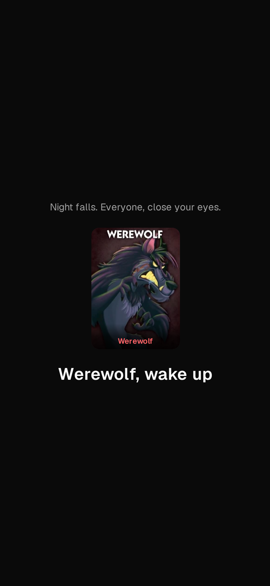
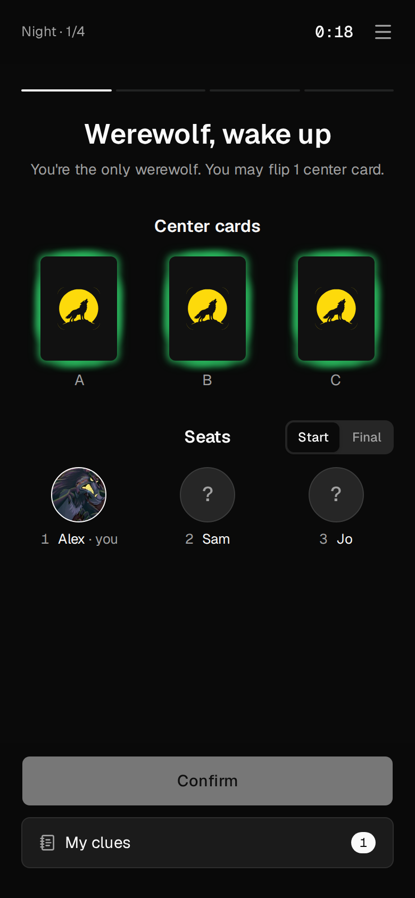
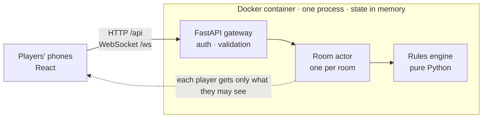

# One Night Ultimate Werewolf · Web

[简体中文](README.md) | English

<p align="center">
  
</p>

<p align="center">
  
  
  
</p>

A self-hosted companion for the board game *One Night Ultimate Werewolf*

## Screenshots

<p align="center">
  
  
</p>

## Deploy

```bash
git clone https://github.com/961853266hyt/ultimate-one-night-wolf.git wolf && cd wolf
echo "UONW_SECRET_KEY=$(openssl rand -hex 32)" > .env
docker compose up -d --build
```

The Dockerfile downloads dependencies from mirrors in mainland China by default. Outside China, build from the official registries instead:

```bash
docker compose build \
  --build-arg DOCKER_REGISTRY=docker.io \
  --build-arg NPM_REGISTRY=https://registry.npmjs.org \
  --build-arg PYPI_INDEX=https://pypi.org/simple
docker compose up -d
```

## Architecture


