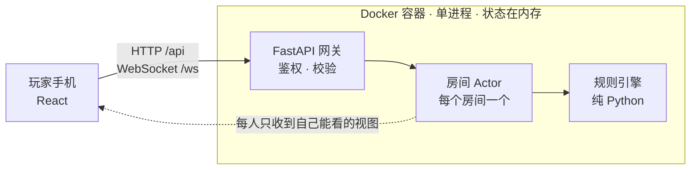

# 一夜终极狼人 · 网页版

<p align="center">
  
</p>

<p align="center">
  
  
  
</p>

一个自部署的《一夜终极狼人》桌游助手

## 部署

```bash
git clone https://github.com/961853266hyt/ultimate-one-night-wolf.git wolf && cd wolf
echo "UONW_SECRET_KEY=$(openssl rand -hex 32)" > .env
docker compose up -d --build
```

## 架构


