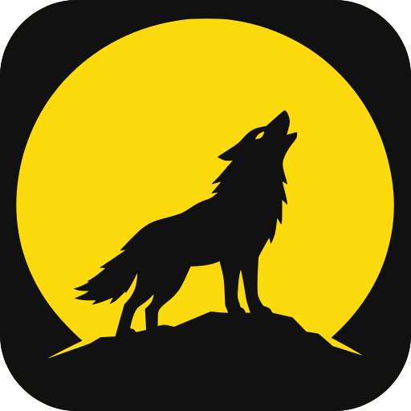
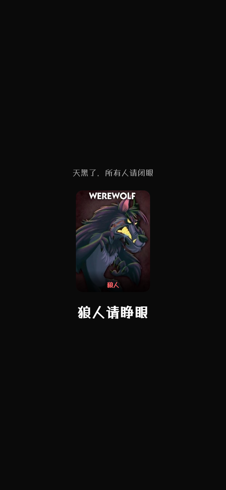
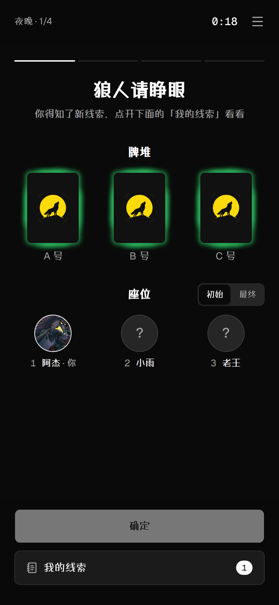
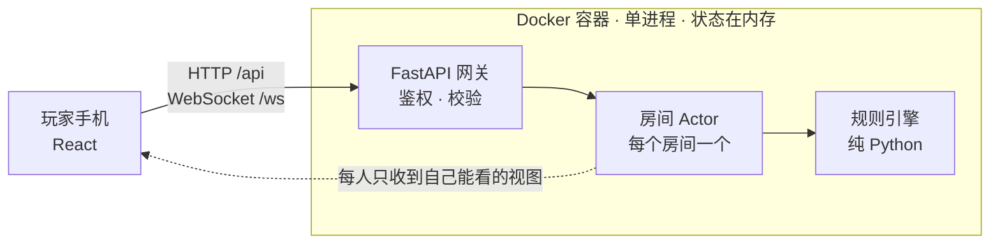

# 一夜终极狼人 · 网页版

简体中文 | [English](README.en.md)

<p align="center">
  
</p>

<p align="center">
  
  
  
</p>

一个自部署的《一夜终极狼人》桌游助手

## 截图

<p align="center">
  
  
</p>

## 角色进度

已实现 14/80 个官方角色。没实现的角色中文名是非官方译名。

<details open>
<summary>基础版 One Night Ultimate Werewolf · 12/12</summary>

- [x] 化身幽灵 Doppelgänger
- [x] 狼人 Werewolf
- [x] 爪牙 Minion
- [x] 守夜人 Mason
- [x] 预言家 Seer
- [x] 强盗 Robber
- [x] 捣蛋鬼 Troublemaker
- [x] 酒鬼 Drunk
- [x] 失眠者 Insomniac
- [x] 猎人 Hunter
- [x] 皮匠 Tanner
- [x] 村民 Villager

</details>

<details>
<summary>破晓 Daybreak · 1/11</summary>

- [ ] 哨兵 Sentinel
- [ ] 头狼 Alpha Wolf
- [ ] 神秘狼 Mystic Wolf
- [ ] 见习预言家 Apprentice Seer
- [ ] 灵异调查员 Paranormal Investigator
- [x] 女巫 Witch
- [ ] 村庄白痴 Village Idiot
- [ ] 揭示者 Revealer
- [ ] 馆长 Curator
- [ ] 梦游狼 Dream Wolf
- [ ] 保镖 Bodyguard

</details>

<details>
<summary>吸血鬼 Vampire · 1/14</summary>

- [x] 模仿者 Copycat
- [ ] 吸血鬼 Vampire
- [ ] 伯爵 The Count
- [ ] 吸血鬼之主 The Master
- [ ] 伦菲尔德 Renfield
- [ ] 病患 Diseased
- [ ] 丘比特 Cupid
- [ ] 煽动者 Instigator
- [ ] 牧师 Priest
- [ ] 刺客 Assassin
- [ ] 见习刺客 Apprentice Assassin
- [ ] 神射手 Marksman
- [ ] 扒手 Pickpocket
- [ ] 小魔怪 Gremlin

</details>

<details>
<summary>外星人 Alien · 0/12</summary>

- [ ] 外星人 Alien
- [ ] 合成外星人 Synthetic Alien
- [ ] 奶牛 Cow
- [ ] 格鲁布 Groob
- [ ] 泽布 Zerb
- [ ] 领袖 Leader
- [ ] 灵媒 Psychic
- [ ] 无赖 Rascal
- [ ] 揭露者 Exposer
- [ ] 软泥怪 Blob
- [ ] 殡葬师 Mortician
- [ ] 神谕者 Oracle

</details>

<details>
<summary>超级反派 Super Villains · 0/15</summary>

- [ ] 魅惑者 Temptress
- [ ] 偷窥博士 Dr. Peeker
- [ ] 捣乱分子 Rapscallion
- [ ] 7 号喽啰 Henchman #7
- [ ] 镜子人 Mirror Man
- [ ] 邪恶探测仪 Evilometer
- [ ] 烦人小子 Annoying Lad
- [ ] 侦测者 Detector
- [ ] 身份寻回者 Role Retriever
- [ ] 巫毒卢 Voodoo Lou
- [ ] 掉包侠 Switcheroo
- [ ] 自知少女 Self-Awareness Girl
- [ ] 翻牌侠 Flipper
- [ ] 疯狂科学家 Mad Scientist
- [ ] 实习生 Intern

</details>

<details>
<summary>奖励角色包 Bonus Roles · 0/16</summary>

- [ ] 灵光先知 Aura Seer
- [ ] 被诅咒者 Cursed
- [ ] 王子 Prince
- [ ] 见习皮匠 Apprentice Tanner
- [ ] 旁观者 Beholder
- [ ] 夜半怪物 Thing (That Goes Bump in the Night)
- [ ] 侍从 Squire
- [ ] 夺舍者 Body Snatcher
- [ ] 共情者 Empath
- [ ] 诺查丹玛斯 Nostradamus
- [ ] 顾家男人 Family Man
- [ ] 风之温蒂 Windy Wendy
- [ ] 守护者者 Defender-er
- [ ] 海绵 The Sponge
- [ ] 弹射犀牛 Ricochet Rhino
- [ ] 无辜路人 Innocent Bystander

</details>

## 部署

```bash
git clone https://github.com/961853266hyt/ultimate-one-night-wolf.git wolf && cd wolf
echo "UONW_SECRET_KEY=$(openssl rand -hex 32)" > .env
docker compose up -d --build
```

## 架构



## 声明

这是一个非官方的粉丝项目，与 Bezier Games 无关，也没有得到其授权或认可。《一夜终极狼人》（One Night Ultimate Werewolf）是 Bezier Games 的商标，游戏和卡图的版权归 Bezier Games 所有。

本项目免费、不用于商业用途。代码以 [PolyForm Noncommercial 1.0.0](LICENSE) 许可发布，只允许非商业使用；卡图不属于本项目，不在许可范围内。
